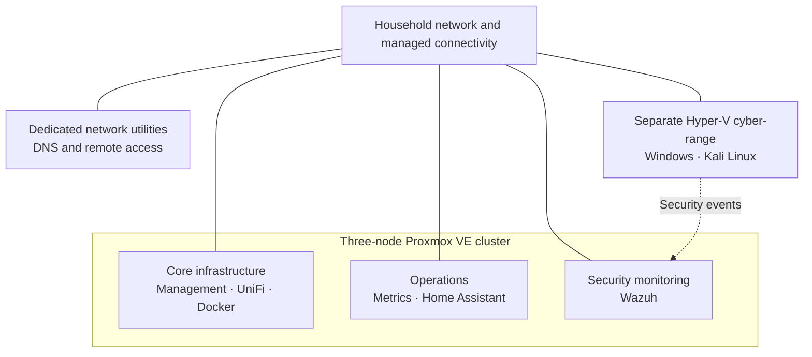

# CMR Lab

*Building, operating and learning from a practical infrastructure lab.*

CMR Lab is a home-based engineering environment built from a mixture of repurposed hardware, virtualisation platforms and self-hosted services. What began as an effort to organise and make better use of existing equipment has developed into a working laboratory for infrastructure operations, network services, monitoring and cybersecurity experimentation.

The objective is not to recreate an enterprise data centre at home. It is to put sound engineering practices to work on real systems: make design decisions, deploy services, observe their behaviour, investigate problems, document the outcomes and improve the environment over time.

The lab also provides services used in everyday life. That creates an important distinction between experiments that can be rebuilt freely and infrastructure that needs to remain dependable.

## The lab today

CMR Lab combines two virtualisation environments with dedicated network utility devices and managed connectivity.

| Area | Implemented environment |
| --- | --- |
| **Core virtualisation** | Three-node Proxmox VE cluster built from a Dell OptiPlex and two Lenovo ThinkPads |
| **Cybersecurity testing** | Separate Hyper-V cyber-range with Windows domain services, a client endpoint, Kali Linux and a controlled gateway |
| **Network services** | Managed switching and Wi-Fi, AdGuard Home DNS and Tailscale remote access |
| **Application hosting** | Docker and Docker Compose running administration, media, utility and documentation services |
| **Observability** | Prometheus, Grafana, Uptime Kuma, cAdvisor and network-device metrics |
| **Security monitoring** | Wazuh collecting security telemetry, including events from the cyber-range |
| **Home automation** | Home Assistant supporting active household integrations |

### Logical overview

This is a logical overview, not a physical network diagram. The [Architecture](docs/03-architecture.md) explains the platforms and their responsibilities in greater detail.

## What the project explores

The value of the lab lies as much in **how systems are operated and improved** as in the technologies installed.

- **Infrastructure and virtualisation:** Proxmox and Hyper-V administration, workload placement and working within hardware limits.
- **Networking and service discovery:** Managed switching, wireless administration, DNS, remote access and internal HTTPS.
- **Applications and service operations:** Docker Compose, application dependencies, health checks and self-hosted utilities.
- **Monitoring and investigation:** Infrastructure metrics, service availability and centralised security events.
- **Security experimentation:** An isolated test environment designed for a repeatable *test → observe → document → harden → retest* workflow.
- **Operational discipline:** Architecture records, decision-making, automation experiments, backups and recovery validation.

These are ongoing areas of practical work, not claims that every capability has reached production-grade maturity.

## Current direction

The focus is on making the existing environment better understood, easier to maintain and more useful for structured experiments.

**Already established:** the Proxmox cluster, separate Hyper-V cyber-range, core network utilities, containerised service platform, infrastructure monitoring, Wazuh event collection and daily-use home automation.

**Continuing work:** refining dashboards, improving maintenance automation, testing recovery procedures and completing the first fully documented cyber-range exercise from initial test through defensive improvement and retesting.

The project treats installation, successful operation and validated recovery as different milestones. Documentation should make those distinctions visible.

## Explore the documentation

| Document | What it covers |
| --- | --- |
| [Architecture](docs/03-architecture.md) | How the deployed platforms and services fit together |
| [Asset Register](docs/02-asset-register.md) | Current equipment, virtual infrastructure and workloads |
| [Services Platform](docs/08-services-platform.md) | Deployed applications, Docker services and their relationships |
| [Lab Charter](docs/01-lab-charter.md) | Purpose, principles and intended learning outcomes |
| [Baseline Inventory](docs/00-baseline-inventory.md) | Equipment available when the project began |
| [Lab Evolution](docs/10-lab-evolution.md) | The project's development and lessons over time |

The current-state documents are updated as the lab changes. Historical records preserve earlier approaches and decisions rather than presenting them as the current configuration.

## The approach

CMR Lab follows a simple principle: **build something useful, understand how it works and preserve what was learned.**

Progress is measured not by the number of systems deployed, but by the ability to explain their purpose, operate them reliably, recognise their limitations and demonstrate improvements with evidence.
