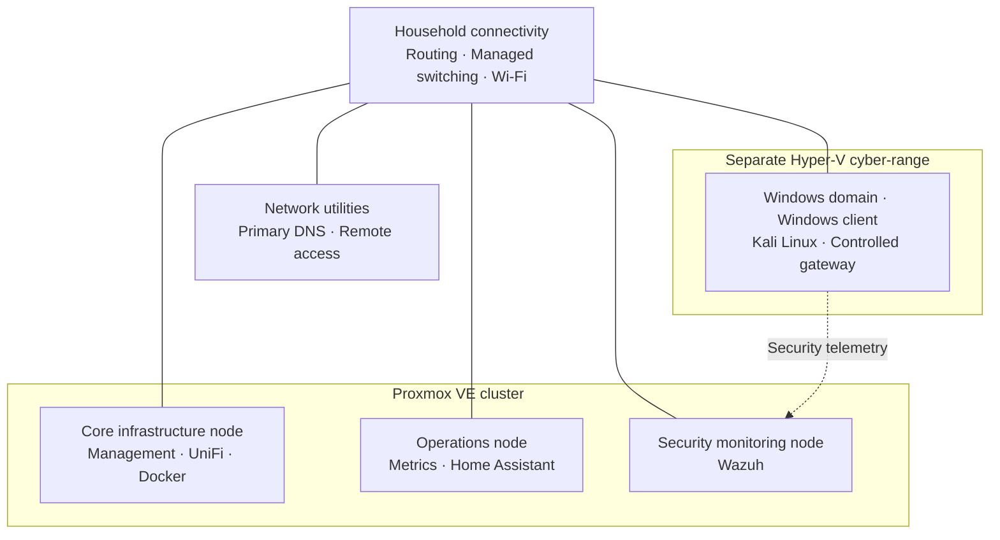

# CMR Lab Architecture

## Overview

CMR Lab is a self-hosted engineering environment that combines household services with practical infrastructure and cybersecurity experimentation. Its architecture uses repurposed hardware, multiple virtualisation platforms and a small collection of dedicated network utility devices.

The environment is organised around a three-node **Proxmox VE cluster** for infrastructure and operational workloads, supplemented by a separate **Microsoft Hyper-V cyber-range**. Selected services run outside the virtualisation hosts where that separation serves a practical purpose.

This document describes the implemented architectural relationships and the responsibilities of the major platforms. The [Asset Register](02-asset-register.md) provides the current equipment and workload inventory. Architectural decisions and changes over time are recorded in the [Decision Log](06-decision-log.md) and [Lab Evolution](10-lab-evolution.md).

## Design principles

The lab is guided by a set of practical engineering principles:

- **Use available resources deliberately.** Assign workloads according to hardware capacity and actual requirements rather than an idealised initial design.
- **Separate responsibilities.** Keep network management, applications, observability and cybersecurity experimentation understandable as distinct functions.
- **Prefer usable infrastructure over unnecessary complexity.** Home automation and other everyday services must remain useful alongside experiments.
- **Build for visibility and recoverability.** Use monitoring, configuration records and backups to support diagnosis, maintenance and future recovery exercises.
- **Test claims, not just deployments.** Distinguish installed services from validated end-to-end behaviour.
- **Preserve the engineering record.** Update the current architecture when it changes while retaining earlier decisions in historical documentation.

## Logical architecture

The diagram is a logical view of the platforms and their relationships, not a physical cabling plan. The Proxmox and Hyper-V environments perform different roles even though they participate in the wider CMR Lab ecosystem.

## Network and foundation services

The Linksys EA4500 remains the household gateway and DHCP server. Wired connectivity is provided through a managed Gigabit Ethernet switch, while a UniFi access point is administered through the UniFi Network Application hosted in the Proxmox environment.

Two Raspberry Pi systems provide dedicated network utility functions:

| Function | Implemented approach | Architectural purpose |
| --- | --- | --- |
| Internal DNS | AdGuard Home on a Raspberry Pi, with a secondary resolver on a management VM | Local name resolution and DNS filtering across the environment |
| Remote access | Tailscale service hosted on a separate Raspberry Pi | Authorised access to lab resources independently of the core virtualisation host |

The DNS services have been configured for synchronisation and tested for resolver failover. This is a network-service design rather than a claim that all workloads have automatic failover.

Internal HTTPS is provided for selected applications through a private certificate authority and reverse-proxy services. The lab's application platform also provides a consistent entry point to many self-hosted services.

## Virtualisation platforms

### Proxmox VE cluster

Proxmox VE provides the main virtualisation foundation. The cluster consists of three physical systems with different workload responsibilities:

| Node role | Hardware | Workload responsibilities |
| --- | --- | --- |
| Core infrastructure | Dell OptiPlex 7010 SFF | Management utilities, secondary DNS, UniFi Network Application and Docker services |
| Operations | Lenovo ThinkPad T440p | Prometheus/Grafana monitoring and Home Assistant |
| Security monitoring | Lenovo ThinkPad T450 | Wazuh security monitoring |

The core infrastructure node hosts separate virtual machines for management, network administration and containerised applications. This keeps their operating environments distinct while allowing them to share the same physical compute platform.

The two Lenovo systems were originally considered for a more dedicated security operations design. Their eventual assignments reflect capacity planning and operational needs: one primarily supports observability and home automation, while the other hosts Wazuh. Cybersecurity test systems were placed elsewhere rather than forcing the entire test environment onto these nodes.

### Hyper-V cyber-range

A separate Microsoft Hyper-V environment runs on the existing Windows engineering workstation. It provides a controlled setting for experimenting with Windows administration, security telemetry and authorised testing.

| Component | Responsibility |
| --- | --- |
| Windows domain controller | Active Directory Domain Services and DNS for the test environment |
| Windows client | Domain-joined endpoint for system and security observations |
| Kali Linux | Testing workstation within the cyber-range |
| Controlled gateway | Restricts and manages selected connectivity between the test environment and monitoring services |

The environment is connected to Wazuh for security event collection, including telemetry from the Windows client. Its intended exercise cycle is **test → observe → document → harden → retest**. The supporting infrastructure and telemetry are deployed; a completed end-to-end exercise cycle remains a future milestone.

## Applications and operational services

### Containerised applications

Docker and Docker Compose provide the primary self-hosted application platform. Workloads are managed as distinct application stacks, making them easier to operate and revise independently.

The platform supports administration and dashboards, availability monitoring, password management, media and library applications, household utilities and an internal MkDocs documentation site. Portainer is used for container administration, while Nginx Proxy Manager provides reverse-proxy functionality for selected internal services.

The detailed application inventory is maintained in the [Asset Register](02-asset-register.md) and [Services Platform](08-services-platform.md) documentation.

### Monitoring and security telemetry

Operational observability and security monitoring are separate but complementary functions.

| Platform | Focus | Sources and use |
| --- | --- | --- |
| Prometheus and Grafana | Infrastructure and service metrics | Host, application and managed-switch metrics; visualisation and investigation |
| Uptime Kuma | Service availability | Endpoint checks and service status tracking |
| Wazuh | Security telemetry | Events collected from systems including the Hyper-V cyber-range |

Monitoring components are deployed and collecting information. Dashboard refinement and more structured investigation exercises form part of the lab's continuing development.

### Home automation

Home Assistant runs as a dedicated Proxmox virtual machine on the operations node and supports daily household use. Its integrations include existing smart-home platforms and Apple Home-related services. Keeping this workload separate from the main application host recognises its ongoing household role rather than treating it as a disposable lab experiment.

## Operations and recovery

CMR Lab uses a combination of virtual-machine backup procedures, recurring configuration archives for network utility devices, infrastructure monitoring and Git-based technical documentation.

Recovery processes and evidence of validation are maintained as operational work rather than presumed to follow automatically from the existence of backups. The related procedures belong in the [Operations Runbook](09-operations-runbook.md).

Architecture, inventory and historical records have different responsibilities. This document describes how the deployed systems fit together; it is revised when those relationships change. The historical reasons for a change are preserved in the [Decision Log](06-decision-log.md) and [Lab Evolution](10-lab-evolution.md).

## Architectural direction

Current development prioritises improving the environment already in use rather than adding services solely for their own sake. Areas of continued work include:

- Refinement of monitoring dashboards and operational visibility
- Documented recovery exercises and automation improvements
- Further cyber-range experiments connecting offensive testing with defensive observations
- Evaluation of a future network gateway replacement
- Maintenance of accurate technical records alongside infrastructure changes

These are development directions, not additional components of the implemented architecture.

## Related documentation

- [Asset Register](02-asset-register.md) — current physical and virtual inventory
- [Baseline Inventory](00-baseline-inventory.md) — initial equipment and starting conditions
- [Decision Log](06-decision-log.md) — reasons behind significant engineering decisions
- [Services Platform](08-services-platform.md) — hosted applications and services
- [Operations Runbook](09-operations-runbook.md) — operational practices and recovery procedures
- [Lab Evolution](10-lab-evolution.md) — historical development of the environment
- [Hyper-V Cyber-Range](13-cyber-range.md) — test environment and evidence method
- [Observability](14-observability.md) — metrics, availability and security telemetry
