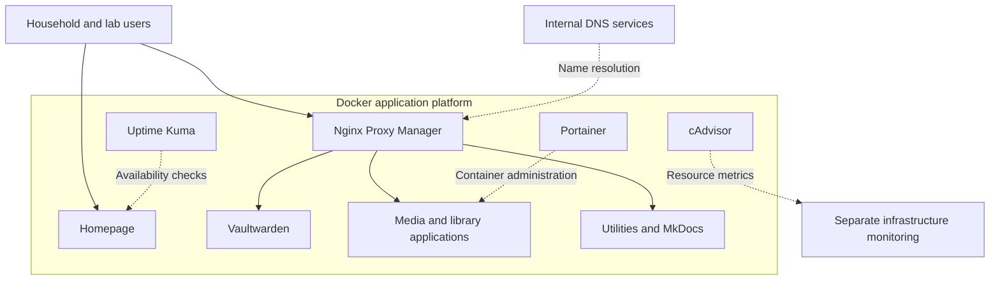

# CMR Lab Services Platform

## Overview

The CMR Lab services platform provides a common home for containerised applications used in household operations, technical experimentation and infrastructure administration. It runs on an Ubuntu Server virtual machine in the Proxmox VE environment and uses **Docker Engine** with **Docker Compose** to organise application deployments.

The platform is one part of the wider lab architecture. Network services, the UniFi controller, Home Assistant, infrastructure metrics and security event analysis have their own hosting arrangements. This separation makes the purpose of each platform easier to understand and keeps general application hosting distinct from other infrastructure responsibilities.

This document describes the **deployed services and their relationships**. The [Architecture](03-architecture.md) describes the overall design, while the [Asset Register](02-asset-register.md) records the current infrastructure inventory.

## Platform design

The application platform is built around a dedicated virtual machine rather than installing every service directly on a Proxmox host. Containers provide application-level separation, while Compose files describe related services and support repeatable deployment and maintenance.

The environment uses multiple Compose projects, allowing general administration services, media applications, documentation and other utilities to be managed as separate groups. **Portainer** provides a graphical view of containers and their status. **Homepage** brings frequently used services together in a dashboard.

The principal platform responsibilities are:

- Hosting and organising self-hosted applications
- Providing service dashboards and container administration
- Supporting application availability checks and resource metrics
- Offering reverse-proxy access to selected internal applications
- Running household media, utility and documentation services

Infrastructure DNS, wireless-network control, host-level monitoring and security telemetry are maintained outside this Docker VM, although the services platform depends on parts of that wider environment.

## Service catalogue

The following catalogue reflects the application deployments observed during the October 2026 infrastructure review. A running container confirms that its process was present at the time of inspection; it does not, by itself, establish that every feature or external integration has been tested end to end.

### Administration and service access

| Service | Function | Implementation |
| --- | --- | --- |
| Docker Engine and Compose | Container runtime and definition of related application stacks | Core platform components |
| Portainer Community Edition | Container inspection and administration | Deployed |
| Homepage | Central dashboard and links to services | Deployed |
| Nginx Proxy Manager | Reverse proxy for selected internal applications | Deployed |
| Uptime Kuma | Application and endpoint availability checks | Deployed |
| Vaultwarden | Self-hosted password vault | Deployed and previously validated over internal HTTPS |

These services form the administration layer of the application platform. They provide different kinds of visibility: Homepage is a service entry point, Portainer describes container state and Uptime Kuma tests service availability.

### Media and library applications

| Service | Function |
| --- | --- |
| Jellyfin | Media library access and playback |
| Calibre-Web | Browser-based ebook library interface |
| Jellyseerr | Media request management |
| Sonarr | Television series management |
| Radarr | Film management |
| Prowlarr | Indexer integration and management |
| qBittorrent | Download client |

The media applications are related but do not perform interchangeable roles. Jellyseerr accepts requests, the media managers coordinate their respective libraries and download activity, Prowlarr supplies indexer integration and qBittorrent handles downloads. Jellyfin presents media from the resulting libraries.

An early request-to-download workflow involving **Jellyseerr, Radarr, Prowlarr and qBittorrent** was validated during the initial deployment. The presence of the full application set is not treated as proof that every later workflow has been revalidated.

### Household, utility and documentation services

| Service | Function |
| --- | --- |
| Minecraft Bedrock server | Household multiplayer game server |
| Stirling PDF | Browser-accessible PDF tools |
| MkDocs with Material for MkDocs | Internal technical documentation site |
| cAdvisor | Container resource metrics for monitoring tools |

The MkDocs site is an internal operational reference. Its deployment is distinct from the public GitHub documentation repository, which maintains the reviewed technical record and version history.

cAdvisor supplies container metrics to the observability environment; it is a supporting component, not a user-facing application dashboard.

## Service relationships

The diagram illustrates the responsibilities of the components, not a complete inventory of proxy rules, network connections or application integrations. Not every service necessarily uses the same access path.

## Related infrastructure services

Several CMR Lab services are important to the user experience but **are not hosted on the Docker applications VM**.

| Platform | Responsibility | Relationship to the services platform |
| --- | --- | --- |
| AdGuard Home | Primary and secondary internal DNS | Resolves internal service names |
| UniFi Network Application | Managed wireless networking | Supports the network used to reach services |
| Prometheus and Grafana | Infrastructure and application metrics | Provides a separate view of operational measurements |
| Home Assistant | Household automation | Runs independently of general container applications |
| Wazuh | Security event collection and analysis | Operates as a separate security monitoring workload |

These systems are described further in the [Architecture](03-architecture.md). Their inclusion here explains dependencies without treating them as containers on the application host.

## Internal access and HTTPS

Internal DNS supplies consistent service discovery, and Nginx Proxy Manager routes requests to selected applications. An internal certificate authority supports HTTPS for several services, including Vaultwarden.

The design is intended to make services easier to access without requiring users to remember individual host addresses and application-specific ports. Certificate trust and HTTPS behaviour can vary by client and application, so an issued certificate alone is not regarded as evidence that every client trusts every service.

## Operations and maintenance

### Container and application state

The platform uses Docker Compose for its principal application stacks. Related containers can be inspected together, and Portainer provides an additional operational interface. Services should be assessed at more than one level:

| Evidence | What it demonstrates | What it does not establish |
| --- | --- | --- |
| Container running | A container process is present | The application is usable end to end |
| Container health check passing | The configured health check reports success | All external dependencies work |
| Availability check passing | A monitored endpoint responded | Every application function succeeded |
| Functional test completed | A defined user workflow was demonstrated | Recovery will succeed after data loss |

This distinction is particularly important for services that rely on other containers, storage, DNS, certificates or integrations.

### Configuration and documentation

Compose definitions provide a repeatable starting point for application deployment. Configuration files, persistent application data and recovery procedures have different responsibilities and must be considered together during maintenance.

Operational commands, environment-specific settings and detailed recovery procedures belong in the [Operations Runbook](09-operations-runbook.md) and internal documentation. Changes that alter the responsibilities of the application platform should also be reflected in the [Architecture](03-architecture.md) and the [Asset Register](02-asset-register.md).

### Recovery and validation

The lab uses virtual-machine and configuration backup processes, but backup creation and successful restoration are separate forms of evidence. Service recovery is considered demonstrated only when the relevant application and its data can be restored and tested in a defined exercise.

## Continuing development

The next stage of work focuses on strengthening the operation of services already deployed. Priorities include improving the consistency of application monitoring, maintaining accurate deployment records and validating recovery procedures through practical testing.

The purpose of the platform is not to maximise the number of containers. It is to provide useful services while developing repeatable administration, monitoring and recovery skills.

## Related documentation

- [Architecture](03-architecture.md) — the deployed platforms and their responsibilities
- [Asset Register](02-asset-register.md) — current physical and virtual infrastructure
- [Operations Runbook](09-operations-runbook.md) — operational practices and recovery procedures
- [Decision Log](06-decision-log.md) — reasons behind important technical choices
- [Lab Evolution](10-lab-evolution.md) — history of the environment
- [Observability](14-observability.md) — monitoring systems and their interpretation
