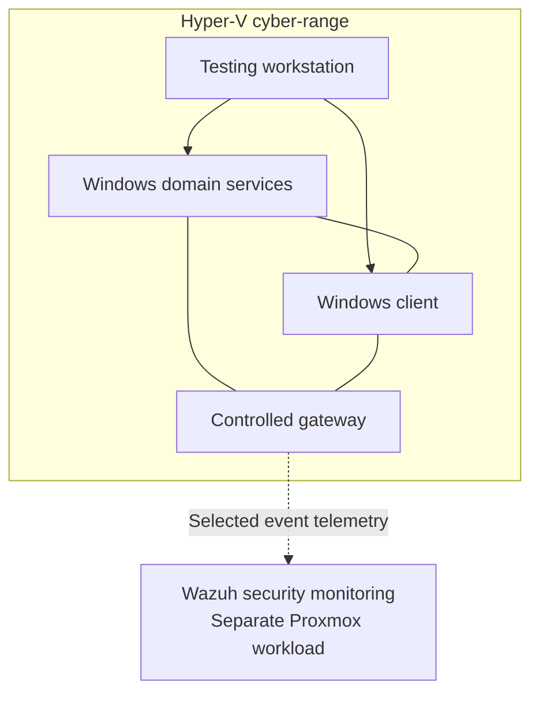

# Hyper-V Cyber-Range

## Purpose

The CMR Lab cyber-range is a separate Microsoft Hyper-V environment for controlled Windows and Linux security experiments. It is designed to support three viewpoints: the system being tested, the machine performing authorised tests and the monitoring platform recording what happens.

The range is **not** a representation of a production corporate network, nor is the mere installation of testing tools evidence of a successful attack.

## Implemented components

| Role | Platform | Purpose |
| --- | --- | --- |
| Domain controller | Windows Server | Active Directory, DNS and Windows domain services in the experiment environment |
| Domain workstation | Windows client | Joined endpoint for policy, access and security event observations |
| Testing workstation | Kali Linux | Authorised discovery and controlled test activity |
| Range gateway | Linux | Deliberately managed connectivity between the experimental environment and selected monitoring functions |
| Security monitoring | Wazuh on Proxmox VE | Collect and inspect test-system events outside the Hyper-V environment |

The cyber-range resides on a Windows workstation separate from the three-node Proxmox cluster. Monitoring integration crosses that platform boundary; the experimental machines remain distinct from household and normal application workloads.

## Logical relationship

The diagram shows roles rather than addressing, access policies or executable routes.

## What has been demonstrated

By late September 2026, the lab had demonstrated domain and client deployment, host-to-host connectivity inside the range and delivery of security events to Wazuh.

Initial discovery and enumeration observations included differences in how Windows domain services and an endpoint firewall responded to probes. In a separate controlled test, an authentication-related event was reflected in Wazuh alerts. These were **observations of a defined test environment**, not evidence of successful compromise or comprehensive detection coverage.

Wazuh collection has also been extended to the Windows client. The supporting environment is established, but a complete, fully documented attack → observe → harden → repeat comparison remains a future project.

## September 2026 build and validation history

### Hyper-V host and network design

The Dell OptiPlex 3070 Micro (Intel i5-8500T, 32 GB RAM) provided a separate host for the experimental guests, reducing pressure on the Proxmox SOC laptops. The arrangement used a Hyper-V Default Switch for upstream NAT access alongside an isolated internal lab switch.

| Guest | Role | Connectivity purpose |
| --- | --- | --- |
| `KALI01` | Linux testing workstation | Interfaces for the internal range and an upstream NAT path |
| `DC01` | Windows domain controller and DNS | Internal range only |
| `CLIENT01` | Domain-connected Windows 11 test endpoint | Internal range only |
| `RANGE-GW01` | Debian-based control gateway | Dual-homed between authorised upstream access and the internal range |

The gateway was added to make selected traffic between the range and outside monitoring systems explicit. This did not convert the isolated lab into a general extension of the household network.

### 19 September: Active Directory and DNS

The Windows domain controller was promoted using Active Directory Domain Services. DNS operation was verified following promotion, including the controller's use of its own domain resolver. Initial SSH and internal-network tests also demonstrated Kali administration and guest connectivity.

### 24 September: Comparing domain and client exposure

Controlled network enumeration showed the domain controller answering on expected services such as DNS, Kerberos, LDAP, SMB and directory/global-catalog functions. The Windows 11 client was reachable but a baseline scan reported the first 1,000 TCP ports filtered. That is a useful observation of differing server/client roles and firewall behaviour, **not** proof that the client has no exploitable weaknesses.

### 25 September: Security events visible in Wazuh

An intentionally incorrect local authentication attempt on `KALI01` produced Wazuh events, including rules **5557** (password check failure) and **5503** (PAM login failure), with an MITRE ATT&CK classification including **T1110.001**. This demonstrated that the tested event made its way from the experiment VM to Wazuh on SOC2.

The Windows client was also integrated into the endpoint telemetry design. A successful agent connection or alert is not a comprehensive security-detection test.

### 26 September: Controlled gateway

A Debian gateway VM was configured with an upstream and an internal-range interface. Connectivity for selected security telemetry was checked as part of the gateway build. Live network ranges, NAT policies and gateway settings are excluded from the public record.

### Remaining milestone

A complete evidence-backed test → observe → document → harden → retest comparison has **not yet been completed**. The existing domain, endpoint, Kali and Wazuh integration provide the foundation for that work.

## Experiment method

A useful cyber-range study should answer a limited, measurable question:

1. **Baseline:** Record what the test machines do before changing controls.
2. **Scope:** Define the owned systems, specific technique and expected observations.
3. **Test:** Carry out the authorised experiment in the designated range.
4. **Observe:** Capture what the endpoint, network and security-monitoring layers actually report.
5. **Interpret:** Compare the observation with the expectation. Avoid turning a missing alert into proof that an action did not occur.
6. **Improve:** Apply a documented defensive change only after the baseline is preserved.
7. **Repeat:** Use the same test and evidence method to understand what changed.

Changes intended solely to improve visibility should be distinguished from changes intended to harden the victim. They answer different questions.

## Reproducibility and evidence

For each exercise, preserve the objective, lab platform versions, scope, baseline, method, sanitised evidence, results, qualifications and retest. Screenshots can help, but commands, relevant output excerpts and explanation are usually more valuable than a large collection of images.

Original evidence may contain sensitive information. Raw event payloads, domain details, network access settings and credentials belong in restricted records. Public reports should reproduce the *finding and method* without exposing the operational test environment.

## Related documentation

- [Architecture](03-architecture.md)
- [Maturity Assessment](04-lab-maturity.md)
- [Observability and Security Monitoring](13-observability.md)
- [Documentation Approach](11-documentation-approach.md)
