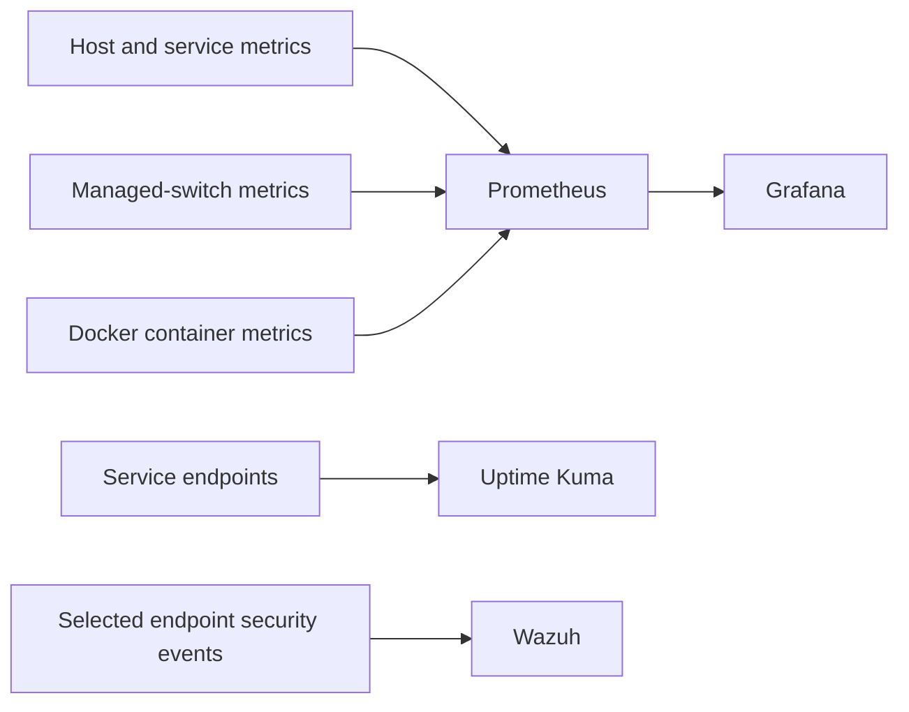

# Observability and Security Monitoring

## Purpose

CMR Lab uses several tools because **availability, performance and security telemetry answer different questions**. The monitoring environment is distributed across the Proxmox cluster and the application platform rather than being a single interchangeable dashboard.

## Monitoring roles

| Component | Type of evidence | Principal use |
| --- | --- | --- |
| Prometheus | Time-series measurements | Collect infrastructure and service metrics |
| Grafana | Queries and dashboards | Explore measurements and trends |
| Host and service exporters | Machine and application metrics | Provide measurements for collection |
| cAdvisor | Container resource metrics | Help inspect the behaviour of Docker workloads |
| Uptime Kuma | Endpoint checks | Observe service availability |
| Managed-switch monitoring | Network-device metrics | Assess aspects of switching behaviour through SNMP |
| Wazuh | Security events and alerts | Observe endpoint and security-relevant activity |

A responding endpoint does not guarantee an application workflow is usable. A CPU chart does not explain every cause of latency. A Wazuh event demonstrates telemetry, not necessarily effective detection of every security technique.

## Placement and relationships

Prometheus and Grafana run in a dedicated monitoring virtual machine in the Proxmox environment. Uptime Kuma and cAdvisor are deployed on the Docker applications platform. Wazuh has its own security-monitoring workload and receives events from selected systems, including the Hyper-V cyber-range.

This is a conceptual data-flow diagram, not a list of addresses, credentials or specific collection configuration.

## Current demonstrated capability

Infrastructure measurements and network-device monitoring have been introduced. Grafana and Prometheus are deployed, while dashboard usefulness and resource interpretation continue to develop. Uptime Kuma supplies service checks from the applications platform.

Wazuh has ingested events from laboratory systems. During controlled September 2026 testing, activity on a test machine produced observable alerts. This establishes that a particular event path worked at that time; it does not establish that every intended endpoint is monitored or every attack would be detected.

## Questions worth answering with evidence

A dashboard should help answer something actionable, for example:

- Did a service outage coincide with a host or link anomaly?
- Is a storage or memory trend consistent with observed application behaviour?
- Is the latest metric fresh enough to support a conclusion?
- Do uptime checks and application-level tests agree?
- Did a controlled test create a recognisable event at both source and monitoring platform?
- Did a measured change improve the outcome when the same test was repeated?

## Validation vocabulary

| Observation | Supported conclusion |
| --- | --- |
| Exporter responds | A metrics endpoint was available during the check |
| Recent metrics visible | Measurements reached the monitoring system |
| Grafana panel displays values | A query and visualisation returned data |
| Uptime check is successful | The defined endpoint check passed |
| Wazuh alert is generated | A particular event was received and matched a detection rule |
| Repeated test with documented comparison | Evidence exists to evaluate whether a change improved the tested outcome |

The final item is a method, not a claim that every monitoring or security workflow has already been completed.

## Continuing development

Future work focuses on reliable dashboard interpretation, measurable alert-quality exercises and cross-checking telemetry against actual host and application behaviour. Tests should be bounded and repeatable, with sensitive output retained privately.

## Related documentation

- [Architecture](03-architecture.md)
- [Services Platform](08-services-platform.md)
- [Hyper-V Cyber-Range](13-cyber-range.md)
- [Operations Runbook](09-operations-runbook.md)
